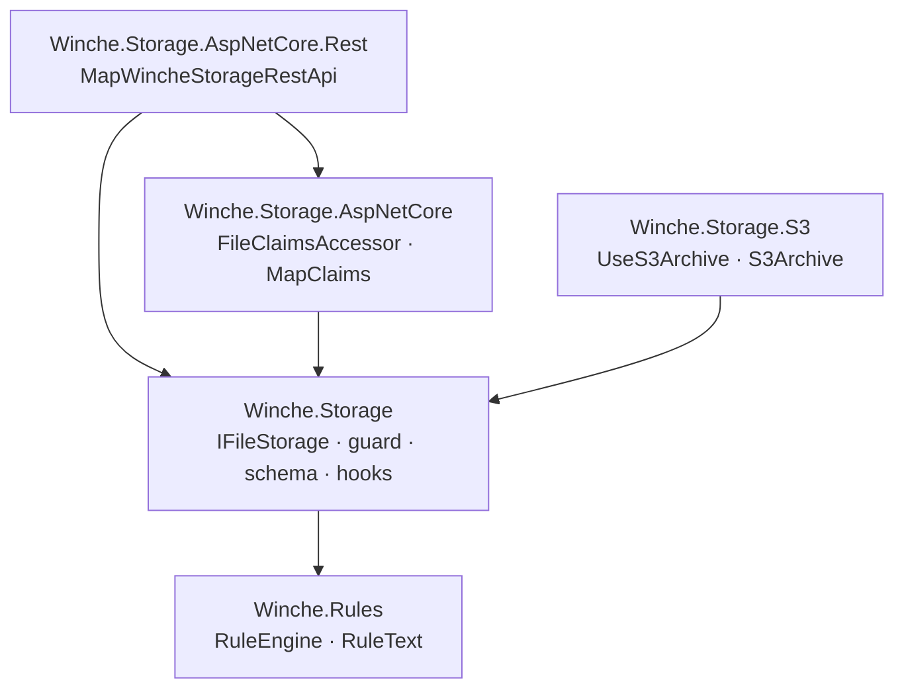
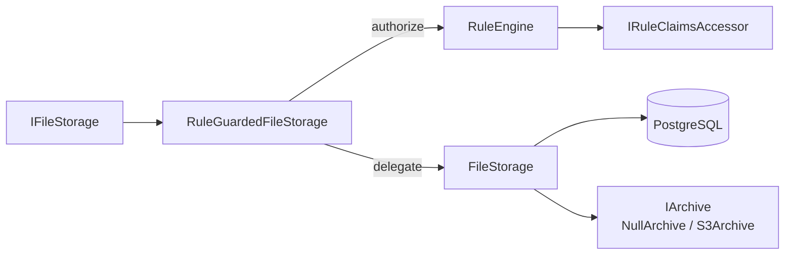
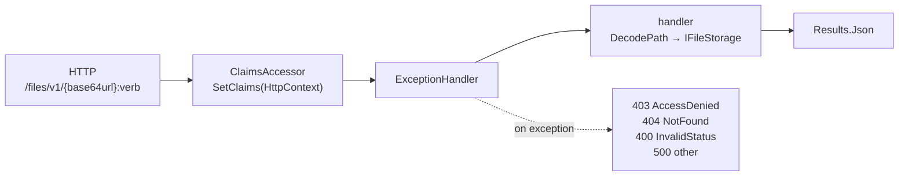
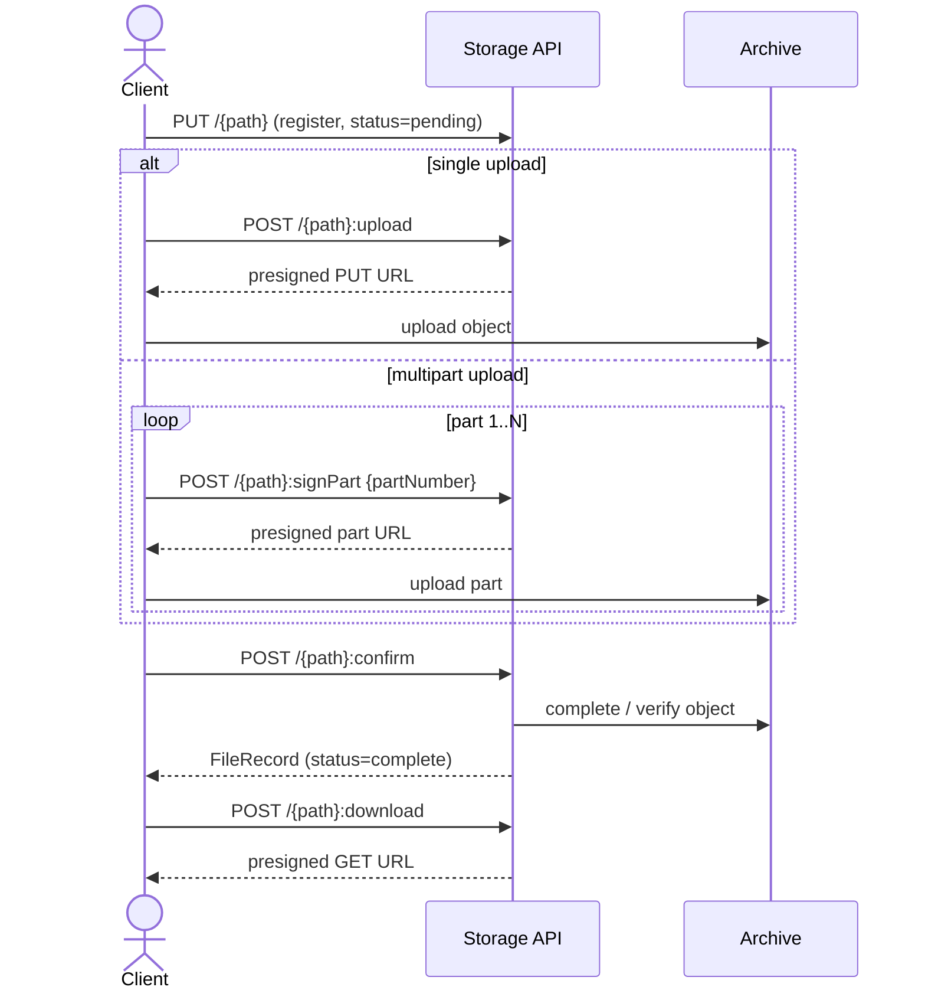
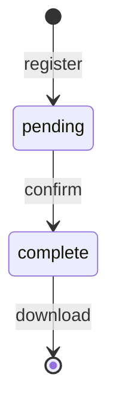
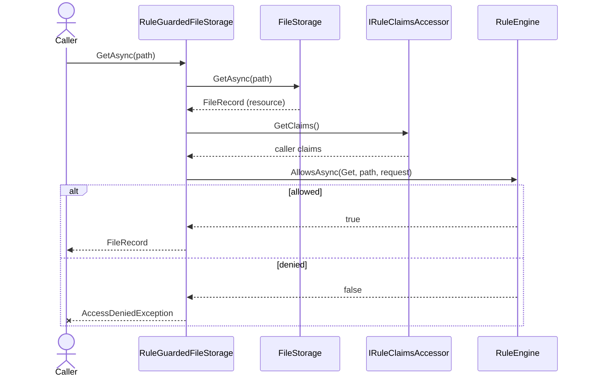

# Winche.Storage

Lightweight .NET libraries for storing file metadata in PostgreSQL and objects in S3-compatible archives via presigned URLs. The solution includes core abstractions, an S3 archive provider, an ASP.NET Core base + REST adapter, and a sample app.

Access control is enforced with [Winche.Rules](https://github.com/FlameOfUdun/winche-rules) — the same Firestore-style rules engine used by `Winche.Database`.

## Packages

| Package | Description |
| --- | --- |
| `Winche.Storage` | Core: schema management, file CRUD, hooks, Winche.Rules guard |
| `Winche.Storage.S3` | S3-compatible archive provider (presigned URLs, multipart upload) |
| `Winche.Storage.FileSystem` | A folder on disk (or a mounted volume) as the archive, through signed URLs your app serves (9.1.0) |
| `Winche.Storage.AspNetCore` | ASP.NET Core base: `MapClaims`, a storage-specific override of the caller the host sets once for every Winche package (`AddWincheCaller` + `UseWincheCaller`, Winche.Core.AspNetCore) |
| `Winche.Storage.AspNetCore.Rest` | Minimal-API REST endpoints (depends on the base package) |

## Architecture

Package dependencies:



Runtime components inside the core. The public `IFileStorage` is the rules guard; it authorizes
through the `RuleEngine`, then delegates to the unprotected `FileStorage`, which talks to Postgres
and the pluggable archive:



## Install

```cmd
dotnet add package Winche.Storage
dotnet add package Winche.Storage.S3
dotnet add package Winche.Storage.AspNetCore.Rest
```

## Quick Start

### 1. Configure `appsettings.json`

```json
{
  "ConnectionStrings": {
    "WincheStorage": "Host=localhost;Database=mydb;Username=user;Password=pass"
  },
  "WincheStorage:S3Archive": {
    "BucketName": "your-bucket",
    "RegionName": "us-east-1",
    "AccessKey": "YOUR_ACCESS_KEY",
    "SecretKey": "YOUR_SECRET_KEY",
    "PresignedUrlExpiry": "00:15:00"
  }
}
```

`AccessKey` and `SecretKey` are optional. Omit them when deploying to AWS with a task role or instance profile — the SDK uses ambient IAM credentials automatically.

For a non-`public` schema, add `Search Path=myschema` to the connection string (the metadata table is created in the connection's `search_path`).

### 2. Register services

```csharp
using Winche.Rules;
using Winche.Rules.Expressions;
using Winche.Storage.AspNetCore.DependencyInjection;       // MapClaims
using Winche.Storage.DependencyInjection;                  // AddWincheStorage
using Winche.Storage.S3.DependencyInjection;               // UseS3Archive

builder.Services.AddWincheStorage(opts =>
{
    opts.ConnectionString = builder.Configuration.GetConnectionString("WincheStorage");

    // Default-deny. Grant access in the rules language (see Access Control).
    opts.UseRulesFile("storage.rules");

    opts.UseS3Archive(s3 => builder.Configuration.GetSection("WincheStorage:S3Archive").Bind(s3));

    // Map HTTP requests to caller claims consumed by the rules engine.
    opts.MapClaims(ctx => new Dictionary<string, object?>
    {
        ["userId"] = ctx.Request.Headers["X-USER-ID"].ToString(),
    });
});
```

### 3. Initialize schema and map endpoints

```csharp
await app.InitializeWincheStorageAsync();   // creates the winche_files table if it doesn't exist
app.MapWincheStorageRestApi();              // maps REST routes under the "files/" prefix
```

See [samples/Winche.Storage.Sample](samples/Winche.Storage.Sample) for a complete working example.

## Configuration

### `AddWincheStorage`

A single overload takes an `Action<WincheStorageOptions>`. Set the connection string and register
components inside the lambda:

```csharp
services.AddWincheStorage(opts =>
{
    opts.ConnectionString = "Host=...;Database=...;Username=...;Password=...";
    opts.UseRules(/* ... */);
    opts.UseHooks(h => h.Add<AuditHook>("userFiles/{userId}/{file=**}"));
    opts.UseS3Archive(/* Action<S3ArchiveOptions> */);
    opts.MapClaims(/* Func<HttpContext, IReadOnlyDictionary<string, object?>?> */);
});
```

### `WincheStorageOptions`

| Member | Description |
| --- | --- |
| `ConnectionString` | _(required)_ Postgres connection string. Schema comes from its `Search Path`. |
| `UseRulesFile(path)` / `UseRulesText(text)` / `UseRules(RuleSet)` | Adds rules to the guard. Multiple calls accumulate (OR-combined). |
| `UseHooks(h => h.Add<T>(path))` | Registers `FileStoreHook` lifecycle listeners, each bound to a Firestore-style path pattern. |
| `UseOrphanSweep(...)` | Enables the background sweep that reclaims archive objects with no matching DB row. See [Orphan Sweep](#orphan-sweep). |

`UseS3Archive` (from `Winche.Storage.S3`) and `MapClaims` (from `Winche.Storage.AspNetCore`) are
extension methods on `WincheStorageOptions`.

### `S3ArchiveOptions`

| Property | Default | Description |
| --- | --- | --- |
| `BucketName` | _(required)_ | S3 bucket name |
| `RegionName` | _(required)_ | AWS region (e.g. `"us-east-1"`) |
| `AccessKey` | `null` | Optional — omit to use ambient credentials |
| `SecretKey` | `null` | Optional — omit to use ambient credentials |
| `PresignedUrlExpiry` | `00:15:00` | Lifetime of generated presigned URLs |

Configure S3 with a delegate (bind from `IConfiguration` yourself if you prefer):

```csharp
opts.UseS3Archive(s3 =>
{
    s3.BucketName = "my-bucket";
    s3.RegionName = "eu-west-1";
});
```

## REST Endpoints

All `{path}` segments are **base64url-encoded** file paths (or directory paths for `:list`). CRUD
uses HTTP methods; per-file operations use AIP-136 colon-verbs (all `POST`).

| Method | Route | Description |
| --- | --- | --- |
| `PUT` | `/{path}` | Register a new file record |
| `GET` | `/{path}` | Get a file record |
| `PATCH` | `/{path}` | Update file metadata |
| `DELETE` | `/{path}` | Delete a file record; the archive object is removed best-effort afterward |
| `GET` | `/ping` | Liveness check |
| `POST` | `/{path}:confirm` | Confirm an upload is complete |
| `POST` | `/{path}:upload` | Generate a presigned upload URL |
| `POST` | `/{path}:download` | Generate a presigned download URL |
| `POST` | `/{path}:list` | List files in a directory (`?mimeType=` filter optional) |
| `POST` | `/{path}:signPart` | Sign a multipart upload part (`{ "partNumber": N }`) |
| `POST` | `/{path}:listParts` | List uploaded parts for a multipart upload |

`MapWincheStorageRestApi` returns a single `IEndpointConventionBuilder` covering every endpoint, so
cross-cutting policy applies to all of them:

```csharp
app.MapWincheStorageRestApi(prefix: "storage")
   .RequireAuthorization();
```

### Request pipeline

Every endpoint runs the built-in `ClaimsAccessor` filter (maps the request to caller claims) and the
`ExceptionHandler` filter (translates exceptions to status codes), outermost, before the handler
decodes the base64url path and calls `IFileStorage`:



### Upload lifecycle

A record is registered first (status `pending`), uploaded directly to the archive via presigned URLs
(single or multipart), then confirmed (status `complete`). Downloads require `complete`:





## Access Control

Authorization is written in the [Winche.Rules](https://github.com/FlameOfUdun/winche-rules) rules language
(Firestore-style) and loaded with `opts.UseRulesFile(...)` or `opts.UseRulesText(...)`; there is no C# builder
(9.0.0). Access is **default-deny**: with no matching `allow`, every protected call throws
`AccessDeniedException`. Multiple calls accumulate and are OR-combined. With the Winche console's rules editor,
the version edited there or deployed with `winche rules deploy` replaces the file's rules at startup.

```text
// storage.rules
match userFiles/{userId}/{rest=**} {
  // Owner has full access to their own subtree.
  allow read, write: if request.auth.token.userId == userId;
}

match public/{rest=**} {
  // Anyone may read public files.
  allow read;
}
```

- Path patterns use `{param}` single-segment captures and a `{name=**}` recursive capture, readable in
  conditions by name (`userId`).
- Operations: `read` (get + list), `write` (create + update + delete), or `get`, `list`, `create`, `update`,
  `delete`.
- The existing file is exposed to conditions as `resource` — e.g. `resource.mimeType`, `resource.sizeBytes`,
  `resource.metadata.ownerId`.
- Caller claims are exposed under `request.auth`: `request.auth.uid` (the `uid` claim, if any) and
  `request.auth.token.<claim>` (any mapped claim).
- A missing file or a syntax error fails at startup, naming the file, line and column.

### Hot-swapping rules at runtime

The guard's engine reads its ruleset from a **mutable repository** on every evaluation, so rules can
be replaced without restarting the app. The write side is registered as a keyed
`IMutableRuleSetRepository` under `WincheStorageKeys.RULE_ENGINE_KEY` — resolve it and call `Update`:

```csharp
using Winche.Rules;
using Winche.Rules.Text;
using Winche.Storage.Constants;

var repo = provider.GetRequiredKeyedService<IMutableRuleSetRepository>(WincheStorageKeys.RULE_ENGINE_KEY);
repo.Update(RuleText.ParseRuleSet("match public/{rest=**} { allow read; }"));
```

The swap is a lock-free atomic reference write: in-flight evaluations keep the ruleset they started
with, and the next call observes the new rules. `Update` replaces the whole ruleset — build the full
set you want live (it is not merged with the rules registered at startup).

Storage operations map to rule operations as follows:

| `IFileStorage` call | Rule operation |
| --- | --- |
| `SetAsync` | `Create` |
| `GetAsync`, `GenerateDownloadUrlAsync`, `ListUploadedPartsAsync` | `Get` |
| `ListAsync` | `List` |
| `UpdateMetadataAsync`, `ConfirmUploadAsync`, `GenerateUploadUrlAsync`, `SignPartAsync` | `Update` |
| `DeleteAsync` | `Delete` |

`ListDirectoryIdsAsync` is intentionally absent from this table: it exists only on the concrete
`FileStorage`, never on `IFileStorage`, and is never rule-evaluated — a privileged, admin-only
operation (see [Privileged: `ListDirectoryIdsAsync`](#privileged-listdirectoryidsasync) below).

### Authorization flow

A protected call loads the current record (as `resource`), gathers caller claims, and asks the
`RuleEngine`. If no rule allows the operation it throws `AccessDeniedException` (default-deny);
otherwise it delegates to the unprotected core. Writes follow the same path, authorizing before the
mutation (a create has no prior `resource`):



### Claims mapping

`MapClaims` (from `Winche.Storage.AspNetCore`) maps the HTTP request to the caller-claims dictionary
the rules engine reads. The dictionary is exposed as `request.auth.token.*`, and a `uid` key (if
present) also as `request.auth.uid`.

```csharp
opts.MapClaims(ctx => new Dictionary<string, object?>
{
    ["uid"]    = ctx.User.FindFirst("sub")?.Value,
    ["userId"] = ctx.Request.Headers["X-USER-ID"].ToString(),
});
```

For non-HTTP callers (background services, tests), inject `FileClaimsAccessor` and call
`SetClaims(...)` directly before invoking `IFileStorage`.

## Where the bytes live

Winche.Storage keeps each file's record (path, type, size, metadata, upload state) in PostgreSQL and its **bytes in an
archive** — `IArchive`. Clients never send bytes through the API: they get a short-lived URL from the archive and upload
or download straight to and from it. Pick an archive, or write one.

### S3 and S3-compatible stores

`opts.UseS3Archive(s3 => …)` (`Winche.Storage.S3`): AWS S3, MinIO, Cloudflare R2, Backblaze B2, Wasabi, …

### A folder on disk (9.1.0)

```csharp
builder.Services.AddWincheStorage(opts =>
{
    opts.ConnectionString = connectionString;
    opts.UseFileSystemArchive(fs =>
    {
        fs.Root = "/var/lib/myapp/files";                          // a local disk, a mounted volume, a network share
        fs.SigningKey = builder.Configuration["Files:SigningKey"]; // 32+ characters; the same on every instance
        fs.PublicBaseUrl = "https://api.example.com";              // optional: the request's own address otherwise
    });
});

app.MapWincheStorageFileSystem();   // serves the URLs, under /_files
```

Upload and download URLs point at your app and are **signed** (HMAC-SHA256): each works only for its method and path,
an upload only up to the size the file was registered with, and only until it expires (an hour by default). Uploads land
in a temporary file and appear whole or not at all; downloads support ranges; multipart uploads work as with S3, each
part capped at `MaxPartBytes`. Several instances can share the folder if it's on shared storage. Browser apps on another
origin need CORS on the `/_files` routes, as they would on an S3 bucket.

### Your own

Implement `IArchive` and register it (`services.AddSingleton<IArchive, MyArchive>()` after `AddWincheStorage`). What it
promises:

| Member | |
| --- | --- |
| `GenerateUploadUrlAsync(path, mimeType, size)` | a URL the client `PUT`s the whole file to (respond with an `ETag`) |
| `GenerateDownloadUrlAsync(path)` | a URL the client `GET`s it from |
| `GetObjectETagAsync(path)` | the stored object's ETag, or null if there's none: confirming an upload checks it |
| `DeleteAsync`, `DeleteObjectsAsync` | remove objects (a missing one isn't an error) |
| `ListObjectsAsync(prefix)` | every object and when it changed, for the orphan sweep |
| `CreateMultipartUploadAsync`, `SignPartAsync`, `ListPartsAsync`, `CompleteMultipartUploadAsync`, `AbortMultipartUploadAsync` | multipart uploads: a URL per part, then assembly in part order |

Anything that can hand out a URL works — another cloud's signed URLs (Azure SAS, Google Cloud Storage), or endpoints in
your own app as `Winche.Storage.FileSystem` does (its source is a complete example).

## Request logging (9.1.0)

`opts.LogRequests()` logs app requests that go through the access rules in the category `Winche.Storage.Requests` as
structured entries — `Operation` (`storage.create`, `storage.get`, `storage.upload`, `storage.confirm`,
`storage.download`, `storage.list`, …), `Path`, `Principal`, `Outcome` (`ok`, `denied`, `notFound`, `invalid`) and
`LatencyMs` — with a plain message: *"u2 was denied deleting uploads/u1/a.png: no rule allows it."* Denied and slow
requests always (Warning), a sample of the rest (Information; `SuccessSampleRate`, default 0.1). The Winche console's
Logs Explorer filters on them.

## Hooks

Implement `FileStoreHook` (behavior only) and register it against a path with
`UseHooks(h => h.Add<T>(path))`. The path is a Firestore-style pattern (literal segments, `{id}`
single-segment captures, and a trailing `{name=**}` recursive wildcard matching **one or more**
segments; bare `*`/`**` are not valid). The same hook type can be bound to multiple paths. Hooks are
dispatched asynchronously.

**Delivery (8.3.0).** File changes — registered, upload confirmed, metadata updated, deleted — reach their hooks
durably: each change writes one delivery per matching hook to `winche_storage_hook_deliveries` **in the same
transaction**, and a background worker on every node runs them (`FOR UPDATE SKIP LOCKED`: each delivery on one
node). So:

- nothing is lost to a restart or a crash — undelivered changes run when a node is back;
- a hook that throws is retried with backoff (1 s, doubling, up to 5 min); after an hour it becomes a **dead
  letter** — `StorageHookDeadLetters` lists, retries (`RetryAsync`) or discards them; kept 7 days;
- one file's events reach a hook in order (a failing one holds back that file's later events for that hook);
- delivery is **at least once**: a hook may see an event twice (a node died mid-call), so make side effects
  idempotent (e.g. skip a report you already emailed).

A hook's identity is its type plus path pattern: renaming either starts a new hook (undelivered rows for the old
one are dropped after 7 days). Tune with `opts.HookDelivery = new HookDeliveryOptions { ... }`. The two URL events
(`OnUploadUrlGenerated`, `OnDownloadUrlGenerated`) change no data and stay best-effort, in memory.

```csharp
public class AuditHook : FileStoreHook
{
    public override Task OnFileRegisteredAsync(FileRecord record, CancellationToken ct) { ... }
    public override Task OnUploadConfirmedAsync(FileRecord record, CancellationToken ct) { ... }
    public override Task OnFileDeletedAsync(string path, CancellationToken ct) { ... }
    public override Task OnMetadataUpdatedAsync(FileRecord record, CancellationToken ct) { ... }
    public override Task OnUploadUrlGeneratedAsync(string path, UploadSession session, CancellationToken ct) { ... }
    public override Task OnDownloadUrlGeneratedAsync(string path, DownloadSession session, CancellationToken ct) { ... }
}
```

Register: `opts.UseHooks(h => h.Add<AuditHook>("userFiles/{userId}/{file=**}"))`.

## Orphan Sweep

`DeleteAsync` treats Postgres as the source of truth: it **commits the row removal first**, then
deletes the archive object best-effort. If the archive call fails, the row is still gone and the
object is left as a harmless **orphan** rather than rolling the delete back (which would leave an
undeletable record). Archive deletes never throw out of `DeleteAsync`.

The background **orphan sweep** reclaims those leftovers. Enable it with `UseOrphanSweep` (requires a
real archive such as `UseS3Archive`):

```csharp
opts.UseOrphanSweep(o =>
{
    o.Interval    = TimeSpan.FromHours(6);    // how often the sweep runs
    o.GraceWindow = TimeSpan.FromHours(24);   // min age before an unreferenced object is purged
    o.Prefix      = null;                     // optional key prefix to scope the sweep
});
```

A hosted service periodically lists the archive and deletes every object that has **no matching
`winche_files` row** and is **older than `GraceWindow`**. The grace window protects in-flight uploads
(object PUT, row not yet committed) from being reaped.

| `OrphanSweepOptions` | Default | Description |
| --- | --- | --- |
| `Interval` | `06:00:00` | How often the sweep runs |
| `GraceWindow` | `1.00:00:00` | An unreferenced object must be older than this to be purged |
| `Prefix` | `null` | Optional key prefix; `null` sweeps the whole bucket |

To run a sweep on demand, call the privileged `PurgeOrphansAsync` on the concrete `FileStorage`
(never on `IFileStorage`, never rule-evaluated — same privileged model as `ListDirectoryIdsAsync`).
It returns the number of objects identified as orphans and submitted for deletion:

```csharp
// concrete FileStorage only — privileged, not rule-guarded
Task<int> PurgeOrphansAsync(string? prefix, TimeSpan graceWindow, CancellationToken ct = default);
```

> Custom `IArchive` implementations must implement `ListObjectsAsync` (added in 7.0) for the sweep to
> work; `S3Archive` already does.

## `IFileStorage`

Inject `IFileStorage` to interact with the store — it always resolves to the rules guard, which
authorizes every call via Winche.Rules. Trusted server-side callers that have no request claims
(background services, hooks, schedulers) should inject the concrete `FileStorage` instead, which is
the unguarded core. This mirrors Winche.Database's `IDocumentDatabase` (guarded) vs `DocumentDatabase`
(unguarded) split.

```csharp
// IFileStorage — every call is authorized via Winche.Rules
Task<FileRecord>               SetAsync(string path, string mimeType, long sizeBytes, JsonObject? metadata, CancellationToken ct);
Task<FileRecord?>              GetAsync(string path, CancellationToken ct);
Task<FileRecord?>              UpdateMetadataAsync(string path, JsonObject patch, CancellationToken ct);
Task<bool>                     DeleteAsync(string path, CancellationToken ct);
Task<UploadSession>            GenerateUploadUrlAsync(string path, CancellationToken ct);
Task<DownloadSession>          GenerateDownloadUrlAsync(string path, CancellationToken ct);
Task<FileRecord>               ConfirmUploadAsync(string path, CancellationToken ct);
Task<IEnumerable<FileRecord>>  ListAsync(string directory, string? mimeType, CancellationToken ct);
Task<UploadSession>            SignPartAsync(string path, int partNumber, CancellationToken ct);
Task<IEnumerable<FilePart>>    ListUploadedPartsAsync(string path, CancellationToken ct);
```

For trusted, claim-less callers, inject the concrete core — same surface, no authorization:

```csharp
public sealed class ReportMailer(FileStorage files)   // concrete FileStorage = unguarded
{
    public Task<DownloadSession> LinkAsync(string path, CancellationToken ct) =>
        files.GenerateDownloadUrlAsync(path, ct);
}
```

### Privileged: `ListDirectoryIdsAsync`

Listing the **immediate sub-directory names** under a directory is a privileged, admin-style
operation. It lives only on the concrete `FileStorage` — never on `IFileStorage` — and is never
evaluated by the rules engine, mirroring Firestore's Admin-SDK-only `listCollectionIds` (and
Winche.Database's `DocumentDatabase.ListCollectionIdsAsync`). It is not exposed over the REST API.

```csharp
// concrete FileStorage only — privileged, not rule-guarded
Task<ListDirectoryIdsResult> ListDirectoryIdsAsync(
    string? parentDirectory, int? pageSize = null, string? pageToken = null, CancellationToken ct = default);
```

Returns the distinct sub-directory names directly under `parentDirectory` (or the top-level
directories when `null`/empty), ordered by UTF-8 byte order. Results are keyset-paginated: pass
`NextPageToken` back as `pageToken` to walk pages (`pageSize` defaults to 100, capped at 300). Files
sitting directly in `parentDirectory` are not sub-directories and are excluded.

```csharp
public sealed class Browser(FileStorage files)   // concrete = privileged
{
    public async Task<IReadOnlyList<string>> SubdirsAsync(string dir, CancellationToken ct)
    {
        var all = new List<string>();
        string? token = null;
        do
        {
            var page = await files.ListDirectoryIdsAsync(dir, pageToken: token, ct: ct);
            all.AddRange(page.DirectoryIds);
            token = page.NextPageToken;
        } while (token is not null);
        return all;
    }
}
```

`ListDirectoryIdsResult` carries `IReadOnlyList<string> DirectoryIds` and a `string? NextPageToken`
(null on the last page).

### `FileRecord`

| Field | Type | Description |
| --- | --- | --- |
| `id` | `string` | Unique record identifier |
| `path` | `string` | Full logical path |
| `directory` | `string` | Parent directory segment |
| `mimeType` | `string` | MIME type |
| `sizeBytes` | `long` | Declared file size |
| `uploadStatus` | `UploadStatus` | `pending`, `complete`, or `failed` |
| `uploadId` | `string?` | Multipart upload ID (when active) |
| `contentHash` | `string?` | Archive object fingerprint (ETag); set on confirm |
| `metadata` | `JsonObject` | Arbitrary key/value metadata |
| `version` | `long` | Optimistic-concurrency version counter |
| `createdAt` | `DateTime` | Creation timestamp |
| `updatedAt` | `DateTime` | Last-modified timestamp |

## Requirements

- .NET 10 SDK (`net10.0`)
- PostgreSQL for metadata storage
- An S3-compatible bucket for object storage (AWS S3, MinIO, etc.)

## License

Elastic License 2.0
